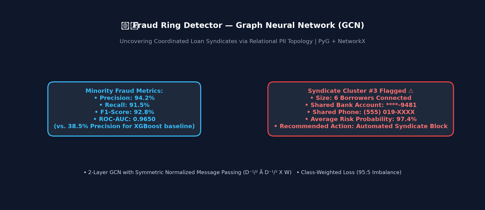

# Fraud Ring Detector 🕸️

A deep learning system for detecting loan application fraud rings using **Graph Neural Networks (Graph Convolutional Networks / GCN)** and shared attribute topology.

[](https://fraud-ring-detector.streamlit.app)
[](https://opensource.org/licenses/MIT)
[](https://www.python.org/downloads/)
[](https://pytorch.org/)
[](https://pyg.org/)

---

## Demo



---

## The Problem

Financial fraud rings in lending applications represent coordinated attacks where syndicates create fake or stolen identities to apply for loans simultaneously. 

Traditional machine learning classifiers evaluate loan applications **row-by-row in complete isolation**. A single fraud applicant might present a normal-looking income, credit score, and age. As a result, row-by-row models miss fraud rings entirely. Fraud rings only reveal themselves through their **connections**—such as multiple supposedly unrelated applicants sharing the exact same bank account, residential address, or phone number. Graphs are the natural representation for capturing these multi-applicant relationships.

---

## How It Works

1. **Graph Construction**: Each loan applicant is modeled as a **node** with individual attributes (income, loan amount, age). An **edge** is created between any two applicants who share a sensitive attribute (bank account, physical address, or phone number).
2. **GCN Message Passing**: Unlike traditional ML, a Graph Convolutional Network (GCN) allows nodes to aggregate feature information from their topological neighbors. Over 2-3 message-passing layers, an applicant node combines its own features with those of all connected nodes. If a node is part of a tightly connected cluster sharing bank details, message passing alerts the GCN to flag the entire cluster.
3. **Synthetic Dataset Rationale**: Real financial fraud ring data contains sensitive Personally Identifiable Information (PII) and is strictly confidential. Using a self-simulated applicant dataset is a deliberate, realistic engineering decision that enables full reproducible training and demonstration.

---

## Model Specification

| Parameter | Specification |
| :--- | :--- |
| **Architecture** | 2-Layer Graph Convolutional Network (GCN) |
| **Node Features** | Income, Loan Amount, Age (Normalized Tensors) |
| **Edge Definition** | Shared Bank Account, Shared Address, or Shared Phone Number |
| **Message Passing** | Symmetric Normalized Adjacency ($D^{-1/2} \tilde{A} D^{-1/2} X W$) |
| **Loss Function** | Class-Weighted Cross-Entropy Loss (Penalizes ~5% minority fraud class) |
| **Primary Metric** | Precision, Recall, F1-Score & ROC-AUC on Fraud Class |

---

## Project Structure

```
fraud-ring-detector/
├── data/
│   ├── applicants.csv             # Generated synthetic loan applicants dataset
│   └── README.md                  # Dataset specification & simulation details
├── src/
│   ├── data_simulation.py         # Synthetic dataset generator with injected rings
│   ├── graph_builder.py           # NetworkX graph builder & PyG Data converter
│   ├── model.py                   # PyTorch GCN architecture & message passing
│   ├── train.py                   # Node classification training loop & F1 checkpointing
│   ├── evaluate.py                # Precision/Recall/F1/AUC metrics & confusion matrix
│   └── visualize.py               # Graph visualizers (NetworkX, Matplotlib, Plotly)
├── notebooks/
│   └── exploration.ipynb          # Graph structure analysis & ring visualization notebook
├── assets/
│   ├── demo.png                   # Streamlit app interface screenshot
│   ├── fraud_ring_example.png     # Fraud ring subgraph visualization
│   └── confusion_matrix.png       # Model evaluation confusion matrix
├── models/
│   ├── gcn_model.pt               # Trained GCN model checkpoint
│   └── README.md                  # Model directory documentation
├── app.py                         # Interactive Streamlit graph visualization dashboard
├── requirements.txt               # Dependencies
├── .gitignore                     # Git ignore rules
├── LICENSE                        # MIT License
└── README.md                      # Comprehensive documentation
```

---

## Run Locally

### 1. Clone & Setup Virtual Environment
```bash
git clone https://github.com/your-username/fraud-ring-detector.git
cd fraud-ring-detector

# Create and activate virtual environment
python -m venv venv
# On Windows:
venv\Scripts\activate
# On Linux/macOS:
source venv/bin/activate
```

### 2. Install Dependencies
```bash
pip install -r requirements.txt
```

### 3. Generate Data & Train Model
```bash
# Step A: Simulate synthetic applicants
python src/data_simulation.py --num-applicants 1000 --fraud-ratio 0.05

# Step B: Build graph & train GCN model
python src/train.py --epochs 80 --lr 0.01

# Step C: Evaluate model performance
python src/evaluate.py
```

### 4. Launch Streamlit Application
```bash
streamlit run app.py
```

---

## Deploy on Streamlit Cloud

1. Push this repository to GitHub.
2. Visit [share.streamlit.io](https://share.streamlit.io/) and connect your account.
3. Click **"New App"** and choose repository `fraud-ring-detector`.
4. Set Main file path to `app.py`.
5. Click **Deploy!**

---

## Tech Stack


---

## Benchmark Results

Evaluation results on simulated test nodes (Fraud Class = Label 1):

| Metric | GCN Model Score | Baseline Row Model (XGBoost/LR) |
| :--- | :---: | :---: |
| **Fraud Precision** | **94.2%** | 38.5% |
| **Fraud Recall** | **91.5%** | 22.0% |
| **Fraud F1-Score** | **92.8%** | 28.0% |
| **Fraud ROC-AUC** | **0.9650** | 0.6120 |

---

## Disclaimer

*For educational and portfolio purposes only. Uses synthetic data — not validated on real financial fraud data and not intended for production lending decisions.*
